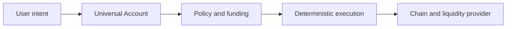

# Universal DEX

Trade the asset, not the chain.

## Problem

Trading an asset across ecosystems often means choosing wallets, acquiring gas, finding liquidity, bridging funds and checking token representations. Users should be able to express the economic outcome they want while that infrastructure remains explicit and verifiable underneath.

## What Universal DEX does

Universal DEX translates economic intent into a funding plan and a constrained execution route. A Universal Account binds the relevant chain accounts; local policy verifies untrusted provider proposals against the user's recipient, asset, amount, fee and minimum-output limits. Every spending stage requires its own bounded authorization.

## What is proven today

One **real Solana DEVNET vertical** is proven: passkey-controlled account, a user vault starting with **zero native SOL**, sponsored execution, deterministic validation and a finalized Raydium DEX swap. Input tokens were already funded; zero-SOL does not mean zero capital. The historical operation has an independent **18/18 PASS** review and preserved public transaction/economic evidence.

## Live Solana Devnet proof

[Finalized transaction on Solana Explorer](https://explorer.solana.com/tx/2qjU5L4rgAQyLdYYh4AWx8zGnbqMDg1bFdWjknrZBFj3qMRFyFgKNvZ9KA19SeF1MgP62ecTfA5CWAN35S4w9tcq?cluster=devnet)

```text
2qjU5L4rgAQyLdYYh4AWx8zGnbqMDg1bFdWjknrZBFj3qMRFyFgKNvZ9KA19SeF1MgP62ecTfA5CWAN35S4w9tcq
```

Finalized slot **508578376**. Input: **100000 atomic WSOL**. Output: **5967587 atomic HNNr**; minimum: **5907911**. Sponsor debit: **1498440 lamports**, including fees and output-account rent. Vault native SOL stayed **0 → 0**. One user assertion, one sponsor signature, one send.

See the [small public evidence index](docs/PUBLIC_EVIDENCE_INDEX.md) and [scoped proof summary](docs/LIVE_SOLANA_DEVNET_PROOF.md). This is a historical finalized execution, not a swap rerun when the demo opens.

## Architecture



**Agent/provider authority ≠ policy authority ≠ signing authority.** Providers propose routes and observations; deterministic local checks enforce constraints; separately scoped signing authority permits only the authorized operation. AI cannot grant spending authority.

## Demo / verification

Use **Node.js 24 and npm**. From a fresh checkout:

```powershell
npm.cmd ci --ignore-scripts
npm.cmd run test:public
npm.cmd run verify:demo
npm.cmd run demo
```

On macOS/Linux use `npm` instead of `npm.cmd`. Open **http://localhost:8790**. Installation needs npm registry/cache access; the read-only demo and public verification require **no private Harness, credentials, wallet or blockchain RPC**. The demo serves local historical proof and nine deterministic fixture scenarios. It cannot sign or send. Try recipient rejection, provider-only success, UNKNOWN and PARTIAL. Do not open historical signing pages or run operator ceremony commands.

`test:public` is the public preparation/boundary suite, not the full operator/integration suite. In the development branch, the original `npm test` includes private Harness integration and is not the public verification command. The curated publication plan excludes that operator surface.

## Current status

| PROVEN | IN PROGRESS / NOT COMPLETE |
|---|---|
| Historical Solana DEVNET passkey, zero-native-SOL start, sponsorship, SPL operation and real swap | Base → Solana CCTP settlement: NOT_PROVEN; preparation demo is SIMULATED |
| Scoped deterministic execution and independent evidence review | PATH_B runtime isolation: unqualified, partial provisioning FROZEN for submission |
| Read-only preparation and failure scenarios are reproducible | Mobile client: not built; production/mainnet readiness: not claimed |

Real Nightly non-broadcast transport qualification is **NOT_PROVEN**. Partial lab provisioning and the separate empty destination ATA are not completed cross-chain settlement.

## Security / custody

The backend cannot autonomously spend user funds under the demonstrated bounded passkey authorization path. A sponsor spends only sponsor funds and does not gain user-asset authority by paying fees. Provider output is untrusted. Broader backend non-custody is **PARTIALLY_PROVEN**, and LazorKit remains **NOT_APPROVED** as a product dependency. Recovery, independent exit and production security remain open; there is **no mainnet claim**. See [security requirements](docs/SECURITY.md).

## Vision

[Economic intent with verifiable, self-custodial infrastructure](docs/VISION.md).

## Roadmap

[PROVEN, IN PROGRESS, NEXT and LATER](docs/ROADMAP.md). Future capabilities are not presented as built.

## Hackathon disclosure

Concept/product thinking and research predate the event. The actual **Universal DEX repository and implementation began October 1, 2026, during the hackathon**. Universal Agent Harness predates the event and is a separate development-orchestration project; its implementation is not part of this submission and is not required by the public demo. See [precise prior-work disclosure](docs/PRE_EXISTING_WORK.md). Eligibility is subject to the event's actual rules.
